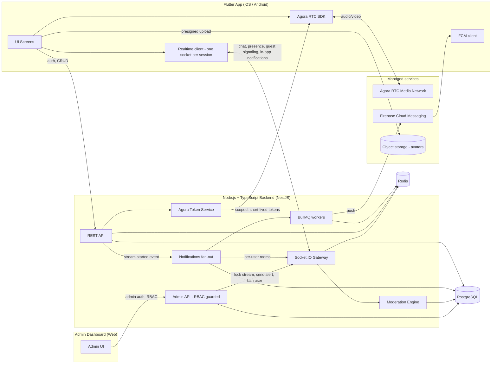
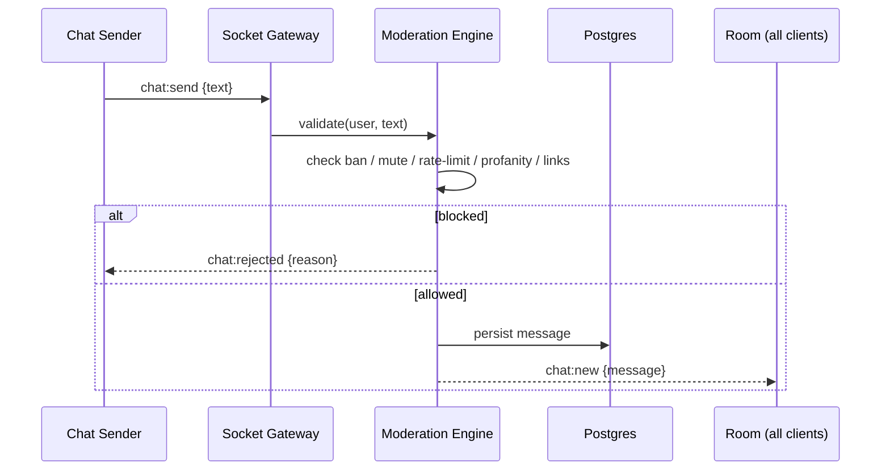
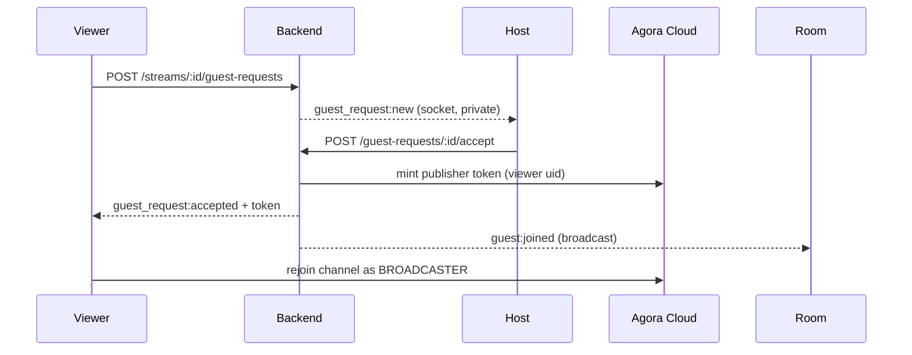
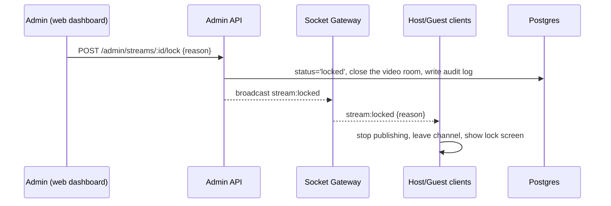
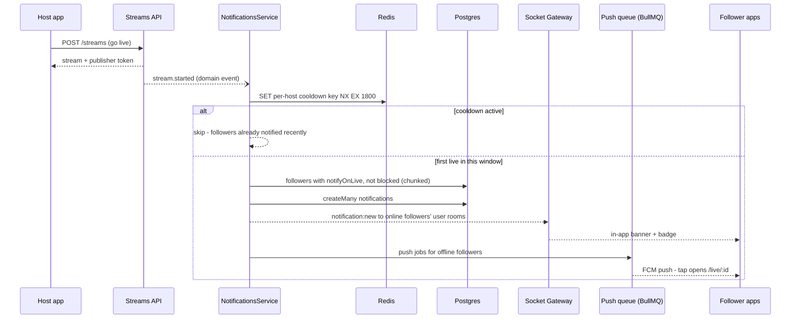

# Live Streaming Platform — Architecture & Feature Plan

Status: **Phases 0–8 (foundations through the admin console) implemented and validated** — see [task-breakdown.md](./task-breakdown.md) for the phase-by-phase status and what's still pending (release readiness, on-device checks), and [features/](./features/README.md) for the per-feature add/modify/remove docs. Revised 2026-09-24 to add profiles & connections (follow graph), go-live notifications, shareable live links, host-chosen moderator abilities, and live-room engagement features; a codebase gap audit added a **Phase 1.5 (hardening)**.
Scope reference: TikTok LIVE-style broadcasting for a gaming/gambling content app.

## 1. Confirmed Requirements (intake answers)

| Decision | Answer |
|---|---|
| Platform | Mobile app, **Flutter** (iOS + Android) |
| Backend | **Node.js + TypeScript** |
| Video/streaming infra | **Managed service** (not self-hosted media servers) |
| Delivery mode | Iterative: plan → build one phase → validate on a real device → next phase (Phases 0–1 done) |
| Target scale | Small — tens to low hundreds of concurrent viewers per stream |
| Compliance (KYC/age-gate/region-lock) & payments/gifting | Deferred — **out of scope for this phase**, but the design leaves room to add them later |
| Admin dashboard | Required in this phase, in full detail — user/stream management, force-lock a live stream, send alerts/notifications during a live, moderation queue, audit log (separate web app, see §6.8) |
| Network efficiency | App must run acceptably on low/unstable internet — lightweight by design (see §7) |
| Host-delegated moderators | Required in this phase — a host can grant/revoke a **Moderator** role (chat + guest moderation powers) to specific users for their own channel, see §6.9 |
| Viewer voice capability | Confirmed invariant: a plain viewer can chat but can never publish audio/video — only Host, Guest, and (once promoted) Moderators-on-stage can speak, see §5 |
| Moderator abilities | Refined — the host chooses **which** moderation abilities each moderator gets (not all-or-nothing), see §6.9 |
| Social connections | Required — users can follow each other; mutual follows are shown as "Friends", see §6.10 |
| Go-live notifications | Required — followers are notified when someone they follow goes live (in-app inbox + realtime banner, then mobile push), see §6.11 |
| Shareable live links | Required — anyone in a live (host, guest, moderator, viewer) can share a link that opens the live directly in the app, see §6.12 |

## 2. Feature Scope

### 2.1 MVP — this phase
1. **Go live / watch** — host broadcasts camera+mic, viewers watch, stream discovery list.
2. **Live text chat** attached to a stream — open to every viewer, guest, and the host; a plain viewer can always chat but can never publish audio/video (see the invariant in §5).
3. **Chat moderation** — automatic filtering of unwanted messages (profanity/spam/links) + host delete.
4. **Block / unblock a user** — personal block, and host-issued room ban/kick.
5. **Guest requests** — a viewer can request to join the host on screen ("raise hand"); host accepts/rejects.
6. **Remove a guest** ("down from guest") — host can remove an active guest; guest can leave voluntarily.
7. **Mute / unmute** — 4 distinct behaviors (self A/V mute, host forced remote mute, room chat mute, personal chat mute). See §6.7.
8. **Admin dashboard** — separate web app for platform staff: user/stream management, force-lock a live stream, send in-stream alerts/notifications, moderation queue, audit log. See §6.8.
9. **Host-delegated moderators with chosen abilities** — a host can grant trusted users a Moderator role scoped to their own channel and pick exactly which powers each one gets (e.g. chat-only vs. full moderation), without making them a platform Admin. See §6.9.
10. **Profiles & connections** — profiles with avatar/bio, user search, follow/unfollow, followers/following lists, mutual follows shown as "Friends", and a "Following" live feed. See §6.10.
11. **Notifications** — when someone goes live, their followers are notified (in-app inbox + realtime banner while the app is open, mobile push when it's closed); also new-follower, moderator-appointed, stage-invite, and live-invite notifications. See §6.11.
12. **Share a live** — any participant can share a live through the native share sheet (the link opens the live in-app, with a lightweight web fallback) or send it straight to friends inside the app. See §6.12.
13. **Live-room engagement** — likes with floating hearts, pinned message, viewer list, a "LIVE has ended" screen with a follow prompt, and a post-live summary for the host. See §6.13.
14. **Direct messages between friends** (client request, 2026-09-30) — two people who follow each other can message privately; an Inbox tab next to Following shows the conversations and an unread badge. See §6.15.

### 2.2 Explicitly deferred (not scheduled in the MVP phases)
- Virtual gifting / monetization / wallet & payments
- KYC, age verification, region locking, gambling-license compliance workflows
- VOD recording/playback, highlights
- "For You" recommendation ranking — the follow graph and notifications moved **into** scope (§6.10, §6.11); algorithmic ranking stays deferred
- Private / connections-only lives, and scheduled lives with "remind me" notifications — the existing `SCHEDULED` stream status and the reserved `follows.status = PENDING` (§8) leave room for both
- Multi-region scaling, horizontal Socket.IO scaling

These are intentionally out of scope so the data model won't fight you later (see §8 — fields like `verifiedAt`/`region` are easy to bolt onto `users` when compliance work starts).

### 2.3 Non-functional requirement: low-bandwidth / lightweight app
The app must work acceptably on slow, capped, or unstable mobile connections — not just fast Wi-Fi. This shapes decisions throughout the plan (conservative default video quality, dual-stream/simulcast, audio-only fallback, no auto-playing preview videos, aggressive pagination). Full strategy in §7.

## 3. Technology Stack

### 3.1 Why a managed video service instead of self-hosting
Running your own WebRTC SFU (mediasoup/Janus/ion-sfu) means owning TURN/STUN infra, media server scaling, and codec/bandwidth adaptation — a lot of undifferentiated ops work for a small team. A managed provider removes that burden entirely and still gives full control over UI/chat/business logic.

Providers evaluated:

| Provider | Flutter SDK | Multi-guest / co-host | Notes |
|---|---|---|---|
| **Agora** | Yes (`agora_rtc_engine`) | Yes — first-class "Interactive Live Streaming" product: promote viewers to co-host, cross-channel co-hosting, built-in chat + moderation add-on | Purpose-built for exactly this TikTok-Live-style use case. 10,000 free RTC minutes/month, then **$3.99 / 1,000 minutes** for HD video (every participant counts; see §14) |
| **LiveKit** | Yes (`livekit_client` / `components-flutter`) | Yes (open-source SFU still fully supports multi-publisher rooms) | LiveKit's current marketing/product focus has shifted heavily toward AI voice/video agents; the underlying media server is still solid WebRTC infra and self-hostable, but Agora's product surface maps more directly to live-streaming + guests + chat + moderation out of the box. **Now also in use, self-hosted - see the update below.** |
| **Amazon IVS (Real-Time Streaming)** | Supported via community/general WebRTC, less turnkey for Flutter | Yes (stages, up to 12 participants) | Good AWS-native option, but weaker Flutter-first tooling and less pre-built moderation/chat tooling than Agora |

**Decision: Agora.** It has a native Flutter SDK, a product explicitly named "Interactive Live Streaming" that matches this exact feature set (promote-to-guest, co-hosting, chat, gifting hooks), a generous free tier for a small-scale MVP, and mature docs.

**Update (2026-09-25): Agora *and* self-hosted LiveKit, switchable.** Agora bills every participant-minute (hosts and viewers), which gets expensive as audiences grow, so LiveKit (Apache-2.0, official Flutter SDK for Android and iOS) now runs on our own server alongside it. `VIDEO_PROVIDER` picks the vendor for new lives; each live keeps the vendor it started on, and the app ships both SDKs, so switching is a backend setting, not an app release. LiveKit's cost is just server bandwidth. See docs/features/video-provider.md.

### 3.2 Chat/signaling transport decision
Agora also sells "Signaling" (RTM, pay-per-message) and "Chat" (persistent messaging, pay-per-MAU) products. We are **not** using either for chat. Reasoning:
- Every requirement here (block unwanted chat, mute, ban, rate-limit) requires **server-side enforcement** — a message must be inspected/approved before it reaches other viewers, otherwise moderation is just cosmetic and trivially bypassed by a modified client.
- Since the backend must sit in the path of every chat message anyway, routing chat through a **self-hosted Socket.IO layer on the same Node.js backend** is simpler (one realtime system instead of two), cheaper (no per-message fees), and keeps all moderation/business logic in code you own.
- Agora is therefore used **only for the media plane** (audio/video), which is the part that's genuinely hard to run yourself.

### 3.3 Final stack

| Layer | Choice |
|---|---|
| Mobile app | Flutter (Dart) |
| Video/audio | Agora RTC SDK (`agora_rtc_engine`) or self-hosted LiveKit (`livekit_client`), switchable per new live (§3); tokens minted server-side |
| Realtime chat/signaling | Socket.IO (`socket_io_client` in Flutter ↔ Socket.IO Gateway in Node backend) |
| Backend framework | Node.js + TypeScript, **NestJS** (modules map cleanly to Auth/Streams/Chat/Guests/Moderation; built-in WebSocket gateway support, guards for auth) |
| ORM / DB | Prisma + **PostgreSQL** (relational data: users, streams, requests, bans fit relational modeling well) |
| Cache / ephemeral state | **Redis** (rate limiting, viewer counts, presence, guest-request queues) |
| Auth | JWT access + refresh tokens |
| Agora token minting | `agora-token` (`RtcTokenBuilder.buildTokenWithUid`) — implemented and verified against the installed package source |
| LiveKit tokens + rooms | `livekit-server-sdk` (`AccessToken`, `RoomServiceClient`) — self-hosted `livekit/livekit-server`, deploy files in `infra/livekit` |
| Admin dashboard | React + Vite + TypeScript SPA — see §3.4 |
| Mobile state & DI | **Riverpod** — one provider graph for repositories, the realtime client, and session/current-user state (replaces each screen constructing its own repositories) |
| Mobile routing & deep links | **go_router** — declarative routes (`/live/:streamId`, `/u/:userId`, …) with an auth redirect; the same routes serve share links (§6.12) and notification taps (§6.11) |
| Push notifications | **Firebase Cloud Messaging** (Android, and iOS via APNs) behind a `PushProvider` interface (§4.1); the backend sends through the Firebase Admin SDK |
| Background jobs | **BullMQ** on the existing Redis — retries/backoff for slow external calls (push delivery), never in a request path |
| Media storage (avatars) | S3-compatible object storage behind a `StorageProvider` interface — **S3Mock** in Docker for dev, S3/R2 in production; clients upload directly with short-lived presigned URLs |
| Scheduled jobs | `@nestjs/schedule` — the host-liveness sweeper (§6.1) |

### 3.4 Admin dashboard front-end choice
The admin dashboard is an internal tool for platform staff, not public-facing, so it doesn't need SEO or server-side rendering. A **React + Vite + TypeScript** single-page app is simpler and cheaper to build and host (plain static hosting) than a full Next.js app. It reuses the exact same backend REST and Socket.IO APIs as the mobile app, under an RBAC-protected `/admin` namespace with its own login. Built (Phase 8) with Tailwind CSS and TanStack Router, Query and Table - see [features/admin.md](./features/admin.md).

## 4. System Architecture



### 4.1 Architecture principles (maintainability & extensibility)
These are the concrete mechanisms — not just goals — that keep it cheap to add or remove features later:

1. **Layered feature modules**: every NestJS module (auth, streams, chat, guests, moderators, moderation, admin) follows Controller → Service → Prisma repository, and only exposes a small public interface to other modules. Changing how a feature works internally shouldn't ripple into unrelated modules.
2. **One authorization layer, not scattered checks**: a single `PermissionsService` answers questions like `canModerate(userId, stream)`, `canManageGuests(userId, stream)`, `canEndStream(userId, stream)`, `canLockStream(userId)`. Every controller calls this instead of inlining `if (hostId === userId)` checks. Adding the Moderator role (§6.9) this round is handled entirely inside this one service — no controller had to change its authorization logic.
3. **Internal domain events, not direct cross-module calls**: modules publish events (`chat.message.deleted`, `guest.removed`, `stream.locked`, `moderator.granted`, etc.) on an in-process event bus (NestJS `EventEmitter2`) instead of importing and calling each other directly. A future feature (e.g. gifting, achievements) can subscribe to existing events without touching the module that emits them.
4. **External services sit behind interfaces**: video vendors are accessed only through an internal `VideoProvider` interface (`getClientConfig`, `createChannelName`, `openChannel`, `mintToken`, `revokeToken`, `closeChannel`), implemented for Agora and LiveKit behind a `VideoProviderRegistry`; the rest of the app never imports a vendor SDK directly (on mobile, the screens use `HostVideoSession`/`ViewerVideoSession`). Swapping/adding a video vendor, or mocking it in tests, means writing one new adapter — nothing else changes. Every new vendor follows the same pattern: push notifications go through a `PushProvider` (FCM today) and avatar uploads through a `StorageProvider` (S3-compatible).
5. **Versioned contracts**: REST routes are prefixed `/v1/...`; the realtime event catalog (§9) is additive-only — new event types are added freely, but an existing event's payload shape is never repurposed, so older clients keep working while new features roll out.
6. **Config-driven feature flags**: new or risky features (a new moderation rule, the future gifting module) are gated behind a flag so they can be turned off instantly without a redeploy.
7. **One migration per schema change**: Prisma Migrate tracks every table addition (like `moderators` this round) as its own reviewable, revertible migration.
8. **Testable seams**: because of 2–4, unit tests mock `PermissionsService` / `VideoProvider` / the event bus instead of a real Agora account or database, so the test suite stays fast as features are added.
9. **Server-side liveness, never client honesty**: the server never relies on a client to announce that it's gone — apps crash, get force-quit, or lose signal mid-live. Anything with a "live" state (a host's stream, presence counts) is backed by a heartbeat with a TTL plus a periodic sweeper, so a stream whose host vanished ends itself instead of lingering in discovery (§6.1).
10. **One realtime connection per app session**: the mobile app keeps a single authenticated Socket.IO connection for the whole session. Every socket automatically joins a private `user:{id}` room (targeted events: notifications, guest acceptance, force-disconnects — to all of that user's devices) and is in at most one `stream:{id}` room at a time. Features never open their own sockets.

## 5. Roles & Permissions

| Role | Description | Can do |
|---|---|---|
| **Admin** | Platform staff, via the separate web dashboard (§6.8) | Suspend/reinstate any user, force-lock/unlock any live stream, send platform-wide or per-stream alerts, delete any chat message, manage the banned-phrase list, resolve reports, view audit logs |
| **Host** | Started the stream | Go live/end, accept/reject guest requests, invite viewers on stage, remove guests, ban/kick, delete and pin chat messages, room-mute chat, force-mute a guest's mic, grant/revoke Moderators and choose each one's abilities |
| **Moderator** | Delegated by a host, for that host's channel (§6.9) | **Only the abilities the host granted them** — any subset of: delete messages, pin messages, room-mute chat, ban/kick, accept/reject guest requests, remove guests, force-mute a guest's mic. **Never**: start/end/lock the stream, edit stream details, or manage other moderators |
| **Guest** | Viewer promoted on-screen | Publish audio/video, self-mute, leave seat, chat, like, share the live |
| **Viewer** | Watching only | Watch, chat (if not muted/banned), like, follow, share the live, request to become a guest, personally block/mute other users |

**Invariant — who can ever speak**: only a Host or a promoted Guest can publish audio/video. A plain Viewer, and a Moderator who hasn't separately been promoted to Guest, are always issued a subscribe-only token (Agora `AUDIENCE` role; LiveKit `canPublish: false`) and can never publish — chat is their only way to participate unless/until they go through the guest-request flow (§6.5). This is enforced by which token type the backend mints (§6.1), not by client-side UI, so it can't be bypassed by a modified client.

Server-side rule: **every** moderation/guest-management endpoint goes through the single `PermissionsService` (§4.1), which checks host, or an active moderator holding that specific capability (§6.9), and every `/admin/*` endpoint re-reads the staff role (`platform_moderator` or `super_admin`) from the database — never trust a client-supplied role claim.

## 6. Feature Design

### 6.1 Go live / watch
- Host taps **Go Live** → `POST /streams` `{title, category}` → backend creates a `streams` row, derives an Agora channel name, mints a **publisher** RTC token (short TTL) → client joins the Agora channel as `BROADCASTER` and starts publishing.
- Viewer opens **Discover** → `GET /streams?status=live` → taps a stream → `POST /streams/:id/join` → backend checks the viewer isn't banned by this host → mints an **audience** RTC token (subscribe-only) → client joins the same Agora channel as `AUDIENCE` and connects to the stream's Socket.IO room for chat/events.
- Viewer count is tracked in Redis and broadcast (throttled) as `viewer_count_update`.
- Host taps **End** → `POST /streams/:id/end` → backend marks the stream ended, emits `stream_ended`, all clients leave the channel/room.
- **Pre-live preview**: the go-live screen opens straight into a full-screen camera preview (`GET /streams/config` returns only the Agora App ID — no stream row or token is created until the host taps "Start broadcasting"), with front/back camera flip, pinch-to-zoom, and camera-app-style zoom stops (1x/2x/4x/8x, derived from each camera's reported maximum zoom).
- **Vertical, full-bleed video**: lives are portrait. Video views crop-to-fill, and live screens never let the keyboard resize the video (the composer/setup panel moves above the keyboard instead). Encoder orientation must be verified on-device — if viewers receive a landscape frame, pin a portrait encoder profile (e.g. 360×640 with a fixed-portrait orientation mode, which the installed SDK exposes).
- **Stage layouts (host's choice)**: the host picks how the live is composed — **Full screen** (crop-to-fill, the default), **Fit** (whole frame, letterboxed), **Split** (video on top, stream details — later chat — below), **Floating** (a draggable mini window that snaps to a corner; double-tap for the larger size), **Minimal** (full-bleed with every overlay hidden until a tap, auto-hiding again after 3 s). The pick is sent with `POST /streams`, can be switched mid-live with `PATCH /streams/:id/layout` (host only), and is relayed to the room as `stream:layout_changed`; late joiners get it in the join response. The last-used layout is remembered on the host's device and preselected next time. The floating window's position and size are per device (each viewer parks it where it suits them); only the layout itself is synced.
- **One live per host**: `POST /streams` auto-ends the host's previous live (if any) before creating the new one, so discovery can never show two lives from the same host.
- **Host liveness (zombie-stream prevention, §4.1 #9)**: the host's app joins the stream's realtime room *as host* and refreshes a Redis heartbeat key (`stream:{id}:host_alive`, TTL ≈ 90 s, refreshed every ≈ 15 s). A sweeper job (every ≈ 30 s) ends any `LIVE` stream whose heartbeat expired, with `endedReason = host_disconnected`. One mechanism covers app crashes, force-quits, the Android back gesture, lost signal, and backend restarts alike; the 90 s window rides out brief drops on weak connections (§7). Viewers see "Host is reconnecting…" (from Agora's remote-video-state callbacks) during the gap instead of a frozen frame.
- `stream_ended` carries an additive `reason` (`host_ended`, `host_disconnected`, `replaced`, `locked`) so clients can show the right copy.
- **Stream detail**: `GET /streams/:id` returns one stream's public state (title, host, status, viewer count) — used by share links (§6.12) and notification taps (§6.11) to choose between joining the live and the "LIVE has ended" screen.
- **Discovery**: the public list only ever returns `live` streams (history and other statuses are admin-only, §6.8), filters by category server-side, includes each stream's live viewer count, and paginates with infinite scroll. Two tabs: **Following** (lives from people you follow, §6.10) and **All**.

### 6.2 Live chat
- Transport: one Socket.IO room per stream (`stream:{id}`), authenticated at socket-connect time via JWT.
- Every message goes through the pipeline in §6.3 before being broadcast — the server is always in the path (never client-to-client direct chat).
- Last N messages persisted so late joiners can see recent history.
- **Added 2026-09-30 (client request)**: the host — and only the host — can post a photo with an optional caption. The app uploads it straight to storage with a presigned URL, then sends the message by its key; the server checks the key belongs to that live (docs/features/chat.md).
- **Added 2026-09-30 (client request)**: viewers can't record the live unless the host allows them, one by one. The app blocks screen recordings and screenshots on Android and covers the live while the screen is recorded on iOS (docs/features/streams.md). A browser watching the share page can't be stopped.

### 6.3 Chat moderation (avoiding unwanted chat)
Layered pipeline, cheapest/fastest checks first:
1. **Input validation** — max length, strip control characters, collapse character/emoji flooding.
2. **Word/phrase filter** — banned-phrase list (supports leetspeak-normalized fuzzy matching); match → reject or mask depending on severity.
3. **Rate limiting** — Redis sliding-window per user per stream (e.g. 1 msg/1.5s, small burst allowance); repeat-offenders get an automatic short mute.
4. **Link policy** — raw URLs blocked by default (common vector for scam/gambling spam) unless domain allowlisted; suspicious patterns ("dm me", "guaranteed win") flagged for host review rather than hard-blocked.
5. **Human moderation** — the host (or a delegated moderator, §6.9) can delete any message in real time (`chat:delete` broadcasts a removal by message id) and mute/ban the sender directly from the message's context menu.
6. *(Future)* third-party toxicity scoring (e.g. Agora's ActiveFence add-on, or a moderation API) run asynchronously post-send so it doesn't add latency to the send path.



### 6.4 Block / unblock
Two distinct mechanisms — both explicitly requested, kept separate:

| | Personal block | Host room ban |
|---|---|---|
| Who triggers | Any user, on any other user | Host or a delegated moderator (§6.9), on a participant in their stream |
| Endpoint | `POST/DELETE /users/:id/block` | `POST/DELETE /streams/:id/bans/:userId` |
| Effect | Blocked user's messages hidden client-side for the blocker; blocked user's streams hidden from the blocker's discovery feed | User is force-disconnected from that stream's chat/guest-queue immediately; scope can be `session` (this stream only) or `host_permanent` (all of this host's future streams) |
| Enforced where | Client-side rendering filter | Server-side — checked before every join/chat/guest-request |

### 6.5 Guest requests ("raise hand" to join)
1. Viewer taps **Request to join** → `POST /streams/:id/guest-requests` (rejected if already banned/already a guest/already pending).
2. Backend queues the request and privately emits `guest_request:new` to the **host and any active moderators holding `MANAGE_GUEST_REQUESTS` (§6.9)**, via their `user:{id}` rooms.
3. Host or a moderator with `MANAGE_GUEST_REQUESTS` **accepts**: `POST /guest-requests/:id/accept` → backend checks active-guest count < configurable max (e.g. 6) → mints a new **publisher** token for that viewer → emits `guest_request:accepted` (with token) privately to them, and `guest:joined` publicly so every viewer's UI adds the new tile.
4. Host or a moderator with `MANAGE_GUEST_REQUESTS` **rejects**: `POST /guest-requests/:id/reject` → private `guest_request:rejected` to the requester only.
5. Requester can **cancel** a still-pending request themselves.
6. **Host invites instead** (the reverse direction): the host picks someone from the viewer list or their friends (§6.13) → `GUEST_INVITE` — an in-live prompt if they're watching, a notification otherwise (§6.11). Accepting follows the same path as an accepted request.



### 6.6 Removing a guest ("down from guest")
- **Host- or moderator-initiated** (moderators need `REMOVE_GUESTS`): taps remove on a guest tile → `POST /streams/:id/guests/:userId/remove` → backend flips that guest row to `removed`, emits a private `you_were_removed` (client downgrades to `AUDIENCE`, stops local tracks) and a public `guest:removed` (other clients drop the tile). Optional cooldown (e.g. 5 min) before that user can request again.
- **Self-initiated**: guest taps **Leave seat** → `POST /streams/:id/guests/leave` — same downgrade flow, no host action needed.
- Ending the stream cascades: all active guests are marked removed.

### 6.7 Mute / unmute
"Mute" is overloaded — the plan defines **four** distinct behaviors so the client/API don't conflate them:

| Type | Triggered by | Effect | Scope |
|---|---|---|---|
| Self A/V mute | Host or Guest, on themselves | Toggles their own mic/camera | Their own publish only (`muteLocalAudioStream`) |
| Host forced remote mute | Host or a delegated moderator (§6.9), on a Guest | Silences a co-host's mic without removing them from stage; a guest who is a moderator can lift it on their own mic (revised 2026-09-29) | That guest, that stream — enforced by the guest's client honoring a `force_mute_audio` event (Agora's media plane is P2P/SFU, so true server-side silencing isn't possible; a guest who ignores it can be escalated to full removal) |
| Room chat mute | Host or a delegated moderator (§6.9), on any participant | That user's chat messages stop being accepted (temporary or until unmuted) | That user, that stream — enforced server-side in the moderation pipeline (§6.3) |
| Personal chat mute | Any viewer, on another participant | Hides that person's messages only for the viewer who muted them | Client-side preference (synced server-side so it persists across devices, but not enforced against the muted user — they're unaffected) |

### 6.8 Admin dashboard & platform moderation
A small internal web app (see §3.4) used by platform staff — a distinct set of powers from the Host/Guest/Viewer roles in §5. Every admin action is server-enforced via an RBAC check and written to the audit log (§11).

**Lock a live stream** (emergency kill switch, distinct from a host's own "End stream"):
- Admin clicks **Lock** on a live stream → `POST /admin/streams/:id/lock` `{reason}`.
- Backend immediately sets `streams.status = 'locked'` and ends the live through the same path as the host's End: the video room is closed (everyone's media drops), guests leave the stage, and the room gets `stream:locked {reason}` followed by `stream_ended` with reason `LOCKED`.
- Host, guests, and viewers all see "An administrator stopped this live" with the reason.
- Locking does **not** by itself suspend the host's account — it stops this broadcast and flags it for review. Stopping the host from going live again is a separate, explicit **suspend account** action (below), so a single bad stream doesn't automatically ban someone.
- `POST /admin/streams/:id/unlock` clears the flag after review; the live stays over, and only the host's devices are told (`stream:unlocked`).

**Send an alert/notification during a live stream**:
- Admin composes a message, chooses a **scope** (`global` = every connected client, or `stream` = one specific live) and **severity** (`info`/`warning`/`critical`) → `POST /admin/alerts` `{scope, streamId?, message, severity}`.
- Backend persists it (`admin_alerts`) and emits `admin:alert` to the target room(s), or every connected socket for `global`.
- The client renders this as a dismissible banner over the video — separate from the chat feed — styled by severity; `critical` alerts require a tap to dismiss instead of auto-hiding.
- Typical uses: a policy warning to one stream, a platform-wide maintenance notice, or a compliance notice, without touching the video/chat pipeline itself.

**User management**: search users, view profile and report history, suspend/reinstate an account (`users.status`).

**Stream oversight**: table of all streams (live/scheduled/ended/locked) with viewer count, duration, and report count; drill into a stream to view its chat log and act directly from there (delete message / ban / lock).

**Moderation queue**: the `reports` table surfaced as a worklist — filter by type, assign to a staff member, resolve with an action and note.

**Banned-phrase list**: CRUD screen over a `banned_phrases` table (a real table, not a static config, specifically so admins can update it without a deploy) — feeds directly into the chat moderation pipeline (§6.3).

**Audit log**: every admin and host/moderator action (lock/unlock, alert, ban, mute, delete, suspend) is queryable — actor, target, reason, timestamp.

**Admin roles**: two tiers on the same login — `super_admin` (everything, including managing other admin accounts and choosing what each platform moderator can do) and `platform_moderator`, who starts with no access and can do only what a super admin gives them, area by area: lives and chat, reports, users, alerts (to one live, or also to everyone), the banned-phrase list and the audit log, each at view or manage level (revised 2026-09-27: first planned as a fixed set of day-to-day powers). Enforced by `AdminGuard` on every `/admin/*` route, which reads the role, account status and permissions from the database on each request - never from the client or a token claim - so a demotion, a suspension or a change of access applies to the very next request. See [features/admin.md](./features/admin.md). (Named **platform moderator** specifically to avoid confusion with the per-host **Moderator** role in §6.9 below, which is a narrower, host-delegated permission, not a platform staff account.)



### 6.9 Host-appointed moderators
A host can delegate moderation of one **running stream** to trusted users, without making them a platform Admin or having to handle every report personally. **A grant is scoped to the stream it was made for — it does not carry over to the host's future streams** (revised 2026-09-26: originally specified as a persistent per-channel role; changed to per-stream so a host can hand a trusted viewer moderation for today's broadcast without that authority quietly persisting into every future one). A host who wants the same person moderating again next time grants them again.

- **Grant**: host-only, and only while the stream is live → `POST /streams/:id/moderators` `{userId, capabilities[]}` → creates/reactivates a `moderators` row scoped to that one stream (`hostId`, `streamId`, `userId`, `capabilities`, `status=active`). Only the host can grant — a moderator cannot appoint another moderator.
- **Change abilities**: `PATCH /streams/:id/moderators/:userId` `{capabilities[]}` → effective on that moderator's very next action; a `moderator:updated` event to their `user:{id}` room updates their UI live (menu items appear/disappear without reconnecting).
- **Revoke**: `DELETE /streams/:id/moderators/:userId` → `status=revoked`, effective immediately; the `PermissionsService` (§4.1) rejects that user's next moderation action.
- **List**: `GET /streams/:id/moderators` (each active moderator **for this stream** with their capabilities) — host-only.
- **Abilities** — the host picks any subset; each maps to exactly one capability flag checked by `PermissionsService`, scoped to that one stream only:

| Capability | Lets the moderator… |
|---|---|
| `DELETE_MESSAGES` | Delete any chat message (§6.3) |
| `PIN_MESSAGES` | Pin/unpin a message at the top of chat (§6.13) |
| `MUTE_CHAT` | Room chat mute/unmute a participant (§6.7) |
| `BAN_USERS` | Kick or room-ban a participant, `session` or `host_permanent` (§6.4) |
| `MANAGE_GUEST_REQUESTS` | Accept/reject requests to join on stage (§6.5) |
| `REMOVE_GUESTS` | Remove a guest from stage (§6.6) |
| `FORCE_MUTE_GUESTS` | Force-mute a guest's mic (§6.7) |

- **Presets**, so hosts never have to think in flags: **Chat moderator** (`DELETE_MESSAGES`, `PIN_MESSAGES`, `MUTE_CHAT`), **Guest manager** (`MANAGE_GUEST_REQUESTS`, `REMOVE_GUESTS`, `FORCE_MUTE_GUESTS`), **Full moderator** (all seven). The UI shows the presets first, with a "Customize" expander for individual toggles. Presets are a client-side convenience only — the backend has no concept of a preset, just the resulting capability set.
- **Authorization shape**: `PermissionsService.hasChannelCapability(requesterId, hostId, grant | null, capability)` — the host always passes; otherwise an active grant containing that capability passes. `grant` is looked up by `(streamId, userId)`, not `(hostId, userId)` — the same interface, just scoped one level narrower than originally specified. A new ability later = one enum value + one check — no controller changes.
- **Not permitted, whatever the capabilities**: start/end/lock the stream, edit stream title/category, grant/revoke other moderators, or anything under `/admin/*`.
- Moderator status is independent of being an on-screen Guest — a moderator can moderate purely from chat/viewer view (holding the same subscribe-only token as any Viewer, per the invariant in §5), or also be brought on-screen through the normal guest flow (§6.5); as a convenience, a host can promote an existing moderator straight to Guest without a queued request.
- Every moderator action is attributed to that specific moderator (not merged into "the host") in the audit log, so a host can see exactly who did what.

### 6.10 Profiles & connections (follow graph)
**Model**: asymmetric **follow** (as on TikTok/Twitch); two people who follow each other are shown as **Friends**. Chosen over a request/accept "connection" model because a host's audience has to grow without the host approving every follower — but `follows` carries a `status` column (`ACTIVE` today, `PENDING` reserved) so an opt-in **private account** mode (follow requests that need approval) can be added later without changing the model.

- **Follow / unfollow**: `POST /users/:id/follow`, `DELETE /users/:id/follow` — idempotent. You can't follow yourself, and you can't follow (or be followed by) someone you blocked or who blocked you; blocking (§6.4) also deletes follows in both directions.
- **Per-follow live alerts**: `PATCH /users/:id/follow` `{notifyOnLive}` — the bell icon on a profile, on by default.
- **Lists**: `GET /users/:id/followers`, `GET /users/:id/following`, `GET /me/friends` (mutual follows) — cursor-paginated (§7).
- **Search**: `GET /users/search?q=` — prefix match on username/display name, cursor-paginated, excludes suspended users and people who blocked you. Needed both for finding people to follow and for appointing moderators (§6.9).
- **Profile**: `GET /users/:id` gains `followerCount`, `followingCount`, `isFollowing`, `isFollowedBy`, `isFriend`, and `liveStreamId` (non-null while they're live — drives a pulsing LIVE ring on their avatar that opens the live). Counts use an indexed `COUNT` at MVP scale; denormalize into counters only if profile reads get hot.
- **Edit profile**: display name, bio, avatar. Avatar upload: `POST /me/avatar/upload-url` → short-lived presigned URL from `StorageProvider` → the client uploads straight to object storage (the API never proxies image bytes) → `PATCH /users/me {avatarKey}`. The client resizes/compresses to ≤ 512 px before upload (§7).
- **Following feed**: `GET /streams?feed=following` (auth) — lives from people you follow; the default discovery tab whenever at least one of them is live.
- **On the live screen**: the host pill (avatar, name, **Follow**) sits top-left on the viewer screen (§6.14) — the highest-intent moment to follow someone.

### 6.11 Notifications
One service, two delivery paths, so every notification type behaves the same way:

| Path | When | How |
|---|---|---|
| **In-app** | Always | A row in `notifications` (inbox + bell badge), plus realtime `notification:new` to the recipient's `user:{id}` room (§4.1 #10) if they're online |
| **Push** | Recipient has no active socket (app backgrounded/closed) and push is enabled for that type | FCM via `PushProvider`, queued on BullMQ with retry/backoff; device tokens FCM reports as invalid are pruned |

**Go-live fan-out** — "notify my connections when I go live":
1. `StreamsService.goLive()` emits a `stream.started` domain event `{streamId, hostId, title}` and returns immediately — fan-out is never in the go-live request path.
2. `NotificationsService` (`@OnEvent`) checks a per-host cooldown (`SET notif:golive:{hostId} NX EX 1800`): a host who restarts a live within 30 minutes (after a crash, say — which §6.1's auto-end makes routine) does **not** notify their followers twice.
3. It selects followers with `notifyOnLive = true`, an active account, and no block in either direction, in chunks (e.g. 1,000), and inserts notification rows with `createMany`.
4. It emits `notification:new` to followers who are online and enqueues push jobs for the rest.
5. Tapping the notification deep-links to `/live/:streamId` (§6.12); if that live has already ended, the app shows the "LIVE has ended" screen with the host's profile instead of an error.



**Types** (additive-only enum, like realtime events, §4.1 #5): `STREAM_STARTED`, `NEW_FOLLOWER`, `STREAM_INVITE` (someone sent you a live, §6.12), `MODERATOR_GRANTED` (§6.9), `GUEST_INVITE` (a host invited you on stage, §6.5). Future types (scheduled-live reminders, gifts) reuse the same pipeline.

**Preferences**: the per-follow bell (§6.10) plus a settings screen (push on/off per type). Push permission is requested **in context** — right after the first follow ("Get notified when {name} goes live?") — never as a cold prompt on first launch, which most people decline.

**Devices**: each signed-in device is a `user_sessions` row (§8) that also holds that device's push token — `PUT /me/push-token` attaches it, and logout deletes the session, so a signed-out (or sold) phone stops receiving someone else's notifications automatically.

**Endpoints**: `GET /me/notifications` (cursor), `GET /me/notifications/unread-count`, `POST /me/notifications/read` `{ids | all}`, `PUT/DELETE /me/push-token`, `GET/PATCH /me/notification-settings`.

**Needed from the project owner** (like the Agora keys): a Firebase project (`google-services.json` / `GoogleService-Info.plist`); for iOS push, an Apple Developer account and an APNs key.

### 6.12 Share a live & deep links
- **Who**: anyone in the live — host, guest, moderator, or viewer — from the share button on the live screen.
- **External share**: the native share sheet (WhatsApp, Telegram, SMS, …) with a prefilled message and an HTTPS link, `https://{app-domain}/live/{streamId}`. HTTPS rather than a custom scheme so it's tappable in every messaging app and survives copy/paste.
- **Opening the link**:
  - App installed → Android **App Links** / iOS **Universal Links** open it straight into the app (`/.well-known/assetlinks.json` and `apple-app-site-association` served from the app domain). In development, before a domain exists, a custom scheme (`gamblinglive://live/{id}`) exercises the same route.
  - App not installed → a tiny server-rendered page at the same URL: stream title, host, live/ended state, "Open in app" / store buttons, and Open Graph tags so the link previews nicely in chat apps. **Revised 2026-09-30 (client request)**: while the live is on, that page is also a small **browser player** (`apps/web`) - the video from the same Agora channel / LiveKit room as audience, the host's name, the viewer count and the chat (read-only), with the app one tap away. On phones, chatting, liking, following and joining the stage all ask for the app (a "Get the app" bar stays visible; after a minute of watching, one install prompt). On a computer, a QR code hands the live to a phone, and a viewer can log in or sign up right on the page (prompted when they try to join in, and once after a minute) to chat, like and follow there; the stage stays app-only. Backend: a short-lived, rate-limited watch ticket for anonymous viewers (`POST /streams/:id/watch`, watch-only sockets) and a cookie-based web sign-in (`/auth/web/*`). Details: docs/features/share.md.
- **In-app routing**: `/live/:streamId` → `GET /streams/:id` → live: join as a viewer; ended: "LIVE has ended" with the host's profile and Follow; locked: the locked notice. Signed out → login first, then continue to the original target (the router preserves it).
- **Send to friends in-app**: a "Send to friends" sheet → `POST /streams/:id/invites` `{userIds[]}` → `STREAM_INVITE` notifications (§6.11). Friends (mutual follows) only, capped per sender per live (e.g. 20) and rate-limited, so it can't be used to spam strangers.
- **Security**: stream ids are unguessable UUIDs, but a link is never an access grant — `POST /streams/:id/join` still enforces bans, blocks, and (future) private-live visibility server-side, so a leaked link can't bypass them.
- **Deferred**: share attribution (`?ref=`) and share analytics.

### 6.13 Live-room engagement
Cheap features with an outsized effect on how "alive" a live feels — none involve payments (gifting stays deferred, §2.2):
- **Likes**: tap the video (revised 2026-09-29: each tap one like, no like button) → floating hearts render immediately (optimistic); the client batches taps into `like:send {count}` at most every ~1 s, the server aggregates in Redis (`INCRBY stream:{id}:likes`) and broadcasts `likes_update {total}` with the same leading+trailing throttle as viewer counts — likes never become per-tap broadcasts. The total is persisted to `streams.likeCount` when the live ends.
- **Pinned message**: the host, or a moderator with `PIN_MESSAGES`, pins one chat message (or a short announcement — "Tonight: high-stakes blackjack") to the top of chat → `chat:pinned` / `chat:unpinned`; one pin per live, stored as `streams.pinnedMessageId`.
- **Viewer list**: tap the viewer count → a sheet of who's watching (paginated from the presence set); each row opens a profile with Follow and, for the host/moderators, moderation actions (§6.4, §6.7) — and "Invite on stage" (`GUEST_INVITE`, §6.5). *Revised 2026-09-29*: those actions live in the profile card's "..." menu — one role-based person menu wherever the card opens (chat, mentions, guest tiles, the viewer list), with Block; a chat message's long-press keeps only Pin, Hide and Delete.
- **"LIVE has ended" screen** (viewers): host avatar and name, Follow, how long the live ran, and "Watch other lives" — instead of silently dropping back to discovery.
- **Post-live summary** (host): duration, peak viewers, total likes, new followers during the live — all from data already tracked (`streams.peakViewerCount` is maintained by the presence service).

### 6.14 Mobile UX blueprint (live room & social surfaces)
Concrete layout and interaction rules, so every new screen extends one design language (`lib/core/theme` + `lib/core/widgets`) instead of looking assembled screen by screen.

**Live room — viewer**: full-bleed video; everything else floats over gradient scrims.
- *Top-left*: host pill — avatar (with LIVE ring), name, **Follow** (collapses to a check once following).
- *Top-right*: stacked avatars of recent viewers + viewer count (tap → viewer list), then close.
- *Bottom-left*: chat overlay — the last ~5 messages, newest at the bottom, the top edge fading into the video (shader mask). Scrolling up reveals history and pauses auto-scroll behind a "New messages" pill; tapping "Say something…" opens the composer above the keyboard.
- *Right rail*: like (with count), share, and — contextually — "Request to join" (§6.5).
- *Clear screen*: swipe sideways to hide every overlay, swipe back to restore; chat can also be toggled on its own.
- *Pinned message*: a slim banner at the top of the chat overlay.
- *System states*: "Host is reconnecting…", "LIVE has ended" (§6.13), locked by an admin (§6.8), weak connection (§7) — each one a designed state, never a raw error or a silent exit.

**Live room — host**: the same layout, plus a top-right control cluster — flip camera, stage layout (§6.1), mic on/off, camera on/off, end (with confirmation) — and pinch-to-zoom. The guest-request badge lives on the right rail (§6.5). The system back gesture while live asks "End your live?" instead of leaving.

**Stage layouts**: every live screen composes through one shared `LiveStage` widget, so host and viewer always see the same arrangement. It fills the screen and positions every child explicitly; the video keeps one element across layout switches (only its frame animates, 240 ms), so the native video view is never re-created. When chat lands (Phase 2) it takes the free space each layout leaves — over the video bottom-left in Full/Fit, the lower sheet in Split, the backdrop in Floating — and Minimal hides it with the rest of the overlays. The "Clear screen" swipe above is the viewer's own version of Minimal.

**Rules that separate a finished product from a prototype**:
- **Skeletons, not spinners**, for anything list-shaped (discovery grid, notifications, followers); spinners only inside a button for sub-second actions.
- **Human error copy** — never render a raw exception (`ApiException(401…)`, `SocketException…`). Every failure maps to a category with written copy and a next step: offline → "You're offline — we'll reconnect automatically"; session expired → silent refresh, otherwise back to login; server error → "Something went wrong on our side" + Retry.
- **Optimistic and reversible** social actions (follow, like, mark-read): update instantly, roll back with a snackbar if the server says no.
- **Motion with purpose**: floating hearts, a subtle pulse on LIVE rings, 150–250 ms transitions — nothing decorative that costs frames on low-end phones.
- **Haptics** on like, follow, going live, and ending a live.
- **Accessibility**: honor system text scaling (no fixed-height text containers), ≥ 44 px touch targets, ≥ 4.5:1 contrast for text over video (the reason the scrims exist), semantic labels on icon-only buttons.
- **Identity and copy**: a real app name and icon, sentence-case labels, and the same verbs everywhere ("Go live", "End live", "Follow", "Request to join").

### 6.15 Direct messages (friends only)
*Client request, 2026-09-30.* Private one-to-one text messages - only between **friends** (people who follow each other, §6.10), so a stranger can't message anyone, and a block (which deletes follows both ways, §6.4) ends it too.
- **Where**: home gets a third tab, **Inbox**, next to For You and Following, with a badge counting unread messages; it lists conversations newest first (last message, time, unread count). "New message" picks a friend; a friend's profile has a **Message** button. On the share page's web player, a signed-in computer gets the same inbox in a drawer beside the live (phones use the app).
- **Sending**: live chat's text rules (§6.3) - cleaning, the banned-phrase filter, the link policy - on messages of up to 1,000 characters, rate-limited per sender, and resend-safe (the app's `clientId`). Anyone who isn't a friend (any more) is refused; the history stays readable, and the composer says why.
- **Delivery**: stored first, then pushed over the realtime connection to both people's `user:{id}` rooms (`message:new`), plus the recipient's unread total (`message:unread_count`). Opening a conversation marks it read (`message:read`), and the sender sees **Seen**.
- **Privacy**: people you blocked are left out of your inbox and count. Staff read messages only on the console's **Private messages** page (a permission of its own), a day at a time - today by default; its list shows who wrote to whom, not what, and every conversation opened is recorded in the audit log.
- **Deferred**: push notifications for messages (needs the Firebase project, like §6.11's push), photos, group conversations.

Details: docs/features/messages.md.

## 7. Low-bandwidth / lightweight app strategy
A core constraint: hosts and viewers may be on slow, capped, or unstable mobile data. The app should degrade gracefully instead of stuttering or failing outright.

**Video/audio (Agora)**:
- Default to a conservative base video profile (roughly 360p, 15–24fps, 400–600 kbps) instead of defaulting to HD; only step up on a demonstrably good connection.
- Enable Agora's dual-stream (simulcast) mode so each viewer automatically receives a resolution matched to their own bandwidth, instead of everyone pulling the host's full-quality stream.
- Configure Agora's publish/subscribe fallback behavior so a degrading connection automatically drops to audio-only instead of freezing or disconnecting (verify the exact current API surface in Agora's docs at implementation time).
- Add an explicit **Data Saver** toggle for viewers that caps resolution and blocks auto-upgrade even on a good connection.
- Surface Agora's network-quality callbacks as a visible "weak connection" indicator instead of silently degrading.

**Chat/signaling**: text-only messages are already cheap — deliberately keep it that way for MVP (no stickers/GIFs/inline images), and keep payloads minimal (id/userId/text/timestamp; resolve avatar/display name from a client-side cache instead of repeating it on every message). Likes are batched on the client and aggregated on the server (§6.13) — never one message per tap — and notification payloads carry ids plus a short title; details load on tap.

**Discovery/feed**: small, compressed static thumbnails for the "live now" list — not auto-playing video previews (a common bandwidth-heavy pattern in TikTok-style feeds that this plan deliberately skips).

**Resilience on flaky networks**: auto-reconnect with exponential backoff for both the Agora channel and the Socket.IO connection; on reconnect, re-sync only the delta (recent chat backlog + current guest list), not a full reload; detect connection loss/type (e.g. via `connectivity_plus`) and show a clear "reconnecting…" state instead of a hard error. Every HTTP call has a timeout (a request must never hang forever on a dead connection), and idempotent GETs retry with backoff.

**General app weight**: lazy-load feature modules, use compressed/cached image loading, avoid heavy unused packages, and paginate every list endpoint (chat history, stream discovery, admin tables) server-side so the client never fetches more than a screenful. Avatars are resized/compressed on the device before upload (≤ 512 px) and shown as small thumbnails in lists.

**Backend**: gzip/br-compress REST responses and keep payloads field-minimal — free to do and directly reduces mobile data usage.

## 8. Data Model (initial)

| Table | Key fields |
|---|---|
| `users` | id, username, displayName, bio (nullable), avatarUrl, passwordHash, platformRole(user/platform_moderator/super_admin), status(active/suspended), suspendedAt, suspensionReason, passwordChangeRequired (seeded/staff-created accounts), lastLoginAt, createdAt |
| `user_sessions` | id, userId, platform(android/ios/web/unknown), refreshTokenHash, previousRefreshTokenHash (reuse grace), rotatedAt, lastSeenAt, createdAt; later pushToken (nullable, §6.11) — one row per signed-in device; replaced the single `users.hashedRefreshToken`, so signing in on a second device no longer signs the first one out |
| `streams` | id, hostId, title, category, status(scheduled/live/ended/locked), layout(full/fit/split/floating/minimal, default full), videoProvider(agora/livekit, fixed at go-live), channelName, startedAt, endedAt, endedReason(host_ended/host_disconnected/replaced/locked, nullable), likeCount, peakViewerCount, pinnedMessageId (nullable), lockedBy (nullable), lockedReason (nullable), lockedAt (nullable) |
| `stream_guests` | streamId, userId, joinedAt, leftAt, status(active/removed) |
| `guest_requests` | id, streamId, userId, status(pending/accepted/rejected/cancelled), requestedAt, resolvedAt |
| `chat_messages` | id, streamId, userId, text, createdAt, moderationStatus(visible/hidden/deleted), flaggedReason |
| `blocks` | blockerId, blockedId, createdAt |
| `room_bans` | hostId, bannedUserId, streamId (nullable), scope(session/host_permanent), createdAt |
| `room_chat_mutes` | streamId, userId, mutedBy, expiresAt (nullable), createdAt |
| `personal_chat_mutes` | userId, mutedUserId, createdAt |
| `moderators` | id, hostId, streamId (scoped to one stream, §6.9), userId, capabilities (enum array, §6.9), status(active/revoked), grantedAt, revokedAt (nullable) |
| `reports` | id, reporterId, targetType(user/message/stream), targetId, reason, status(open/in_review/resolved/dismissed), assigneeId, resolution(content_removed/user_suspended/stream_locked/other_action), resolutionNote, resolvedById, resolvedAt, createdAt, updatedAt |
| `banned_phrases` | id, phrase, severity(reject/mask), createdBy, createdAt |
| `admin_alerts` | id, scope(global/stream), streamId (nullable), message, severity(info/warning/critical), createdBy, recipientCount (devices reached), createdAt |
| `audit_logs` | id, category, action, actorId (nullable), actorRole(super_admin/platform_moderator/host/moderator/user/system), actorLabel, targetType, targetId, targetLabel, streamId, reason, metadata, ip, userAgent, createdAt — append-only; labels captured when written |
| `follows` | followerId, followeeId, status(active/pending — pending reserved for private accounts), notifyOnLive (default true), createdAt — unique(followerId, followeeId), index(followeeId) for go-live fan-out |
| `notifications` | id, recipientId, type(stream_started/new_follower/stream_invite/moderator_granted/guest_invite), actorId (nullable), streamId (nullable), readAt (nullable), createdAt — index(recipientId, createdAt desc) |
| `notification_settings` | userId, type, pushEnabled, inAppEnabled — defaults apply when no row exists |
| `conversations` | id, userAId, userBId (the smaller id first — one row per pair), lastMessageAt, createdAt — unique(userAId, userBId) (§6.15) |
| `direct_messages` | id, conversationId, senderId, recipientId, text, clientId (nullable), readAt (nullable), createdAt — unique(senderId, clientId), index(recipientId, readAt) for the unread count (§6.15) |

## 9. Realtime Event Catalog (Socket.IO)

`chat:new`, `chat:rejected`, `chat:delete` · `guest_request:new`, `guest_request:accepted`, `guest_request:rejected` · `guest:joined`, `guest:removed`, `you_were_removed` · `force_mute_audio`, `presence:audio_state` · `chat:muted`, `chat:unmuted` (room chat mute, to the muted user only, §6.7) · `viewer_count_update` · `stream_ended` · `force_disconnect` (bans) · `stream:locked`, `stream:unlocked` (host only), `admin:alert` (admin actions) · `moderator:granted`, `moderator:revoked`, `moderator:updated` · `chat:pinned`, `chat:unpinned` · `like:send` (client→server), `likes_update` · `notification:new`, `notification:unread_count` · `stream:host_join`, `stream:host_heartbeat` (host→server, §6.1) · `stream:layout_changed` (§6.1) · `stream:watch` (client→server, the web player's watch-only socket, §6.12) · `recording:permission` (to that viewer only, §6.2) · `message:new`, `message:read`, `message:unread_count` (direct messages, to the two people only, §6.15)

Delivery targets: `stream:{id}` rooms (everyone in a live) or `user:{id}` rooms (one person, on all of their devices, §4.1 #10). Payload changes stay additive — e.g. `stream_ended` gaining an optional `reason` field (§6.1) is allowed; repurposing an existing field is not.

## 10. REST API Surface (summary)

```
POST   /auth/signup | /auth/login | /auth/refresh | /auth/logout
POST   /auth/web/signup | /auth/web/login | /auth/web/refresh | /auth/web/logout   (web player: refresh token in an httpOnly cookie, §6.12)
GET/PATCH /users/me
GET    /users/:id                        (public profile + relationship flags, §6.10)
GET    /streams?status=live[&category=][&feed=following]
GET    /streams/config                   (video provider for new lives + what the pre-live camera preview needs)
GET    /streams/:id                      (public stream detail — share links, notification taps)
POST   /streams                          (go live)
PATCH  /streams/:id/layout               (host switches the stage layout mid-live, §6.1)
POST   /streams/:id/join
POST   /streams/:id/watch                (web player: video token + watch ticket, optional sign-in, §6.12)
GET    /streams/:id/recording-permissions               (host only: who may record, §6.2)
POST/DELETE /streams/:id/recording-permissions/:userId  (host only)
POST   /streams/:id/chat/image-upload-url                (host only: a presigned upload for a chat photo, §6.2)
POST   /streams/:id/end
POST/DELETE /streams/:id/pin              (host or PIN_MESSAGES)
GET    /streams/:id/viewers
POST   /streams/:id/invites              (send a live to friends, §6.12)
POST   /streams/:id/guest-requests
POST   /streams/:id/guest-requests/:id/accept|reject
DELETE /streams/:id/guest-requests/:id
POST   /streams/:id/guests/:userId/remove
POST   /streams/:id/guests/leave
POST/DELETE /streams/:id/guests/:userId/mute-audio   (host or FORCE_MUTE_GUESTS, §6.7)
POST/DELETE /streams/:id/bans/:userId
GET    /streams/:id/chat/mutes           (host or MUTE_CHAT)
POST/DELETE /streams/:id/chat/mutes/:userId   ({durationSeconds?} - omitted: until the live ends)
GET    /streams/:id/summary              (host only - post-live numbers, §6.13)
POST/DELETE /users/:id/block
POST/DELETE /users/:id/chat-mute         (personal chat mute, §6.7)
GET    /users/me/chat-filter             (ids this account hides in chat: muted + blocked)
POST   /reports

# Host-delegated moderators (RBAC: host only)
GET    /me/moderators
POST   /me/moderators                    ({userId, capabilities[]})
PATCH  /me/moderators/:userId            (change abilities)
DELETE /me/moderators/:userId

# Profiles & connections (§6.10)
GET    /users/search?q=
POST/PATCH/DELETE /users/:id/follow
GET    /users/:id/followers | /users/:id/following
GET    /me/friends
POST   /me/avatar/upload-url

# Notifications (§6.11)
GET    /me/notifications | /me/notifications/unread-count
POST   /me/notifications/read
PUT/DELETE /me/push-token
GET/PATCH /me/notification-settings

# Direct messages between friends (§6.15)
GET    /me/conversations | /me/conversations/unread-count
GET/POST /me/conversations/:userId/messages   (history with ?before= | send {text, clientId?})
POST   /me/conversations/:userId/read

# Share fallback (unversioned, for browsers — §6.12)
GET    /live/:streamId                   (web fallback page with Open Graph tags; while live, it loads the web player from /web/*)
GET    /.well-known/assetlinks.json | /.well-known/apple-app-site-association

# Admin (RBAC: platform_moderator / super_admin; full list in features/admin.md)
POST   /admin/auth/sign-in | /admin/auth/refresh | /admin/auth/sign-out   (refresh token in an httpOnly cookie)
GET/PATCH /admin/me                   POST /admin/me/password | /admin/me/email
GET    /admin/overview
GET    /admin/streams | /admin/streams/:id | /admin/streams/:id/chat
DELETE /admin/streams/:id/chat/:messageId
POST   /admin/streams/:id/lock | /admin/streams/:id/unlock
GET/POST /admin/alerts                (global: super admin)
GET    /admin/users | /admin/users/:id
POST   /admin/users/:id/suspend | /reinstate | /sessions/revoke
PATCH  /admin/users/:id/profile | /admin/users/:id/role (role: super admin)
GET/POST /admin/staff                 (create: super admin)
GET    /admin/reports | /admin/reports/:id
POST   /admin/reports/:id/assign | /resolve | /dismiss | /reopen
GET/POST/PATCH/DELETE /admin/banned-phrases   (writes: super admin)   POST /admin/banned-phrases/test
GET    /admin/audit-logs | /admin/audit-logs/catalog | /admin/audit-logs/export (CSV)
GET    /admin/messages/conversations | /admin/messages/conversations/:id   (private messages, a day at a time; opening one is audited, §6.15)
```

## 11. Security Checklist (OWASP-aligned)

- **Access control**: every mutating stream/guest/moderation endpoint goes through the single `PermissionsService` (§4.1) — host, or an active moderator for that host (§6.9), or platform admin — instead of ad hoc `hostId === requester.id` checks scattered per-endpoint; never trust a client-supplied role claim.
- **Admin RBAC**: every `/admin/*` route re-checks the role from the database (`AdminGuard`: `platform_moderator`/`super_admin`) — never inferred from the dashboard UI. The console keeps its refresh token in an httpOnly `SameSite=Strict` cookie and its access token in memory only, and sign-in is rate-limited per IP and per account (Phase 8). Given the sensitivity of lock/suspend/alert powers, still add extra network controls (VPN/IP allowlist) and mandatory 2FA for staff before production launch.
- **Token handling**: Agora App Certificate stays server-only (env var); RTC tokens are short-TTL, scoped to one channel+uid+role; JWT access tokens short-lived with refresh rotation; HTTPS/WSS only.
- **Injection**: Prisma parameterizes all queries; chat text always rendered as plain text client-side (never as raw HTML) to avoid injection via chat.
- **Abuse/DoS**: rate limiting on auth, chat send, and guest-request creation; queue caps on guest requests.
- **Misconfiguration**: CORS locked to known app origins; secrets never logged.
- **Auditability**: every moderation action (ban/mute/delete/kick/lock/alert/suspend) logged with actor, target, reason, timestamp for appeals.
- **Session revocation**: a suspended user can't refresh (checked on every `/auth/refresh`), and suspending or room-banning someone force-disconnects their live sockets through their `user:{id}` room — access ends within seconds, not at access-token expiry.
- **Boot-time config validation**: the server refuses to start in production with missing or placeholder secrets (`change-me…`); `helmet` security headers on every response.
- **Uploads**: presigned URLs are short-lived, scoped to one object key, with an enforced content type (JPEG/PNG/WebP) and maximum size; user uploads are served from the storage/CDN domain, never the API origin.
- **Links & invites**: a share link is never an access grant (join re-checks bans/blocks/visibility); in-app invites are friends-only, capped, and rate-limited; notification fan-out skips blocked relationships and suspended accounts.
- **Push tokens**: bound to one device session and deleted with it on logout, pruned when FCM reports them invalid.

## 12. Proposed Project Structure

**Revised 2026-09-30 (client request)**: the monorepo below is now four repositories, one per app, each with its own README, settings template, Docker files and CI/CD: **mela-backend** (`apps/backend`, plus the dev `docker-compose.yml` and `infra/`), **mela-mobile** (`apps/mobile`), **mela-web** (`apps/web`, the share-link player) and **mela-admin-web** (`apps/admin-web`, plus these `docs/` and `branding/`). The tree keeps the original paths, which the rest of the docs use too.

```
Gambling/
├── apps/
│   ├── mobile/                # Flutter app
│   │   └── lib/
│   │       ├── core/          # theme, widgets, router (go_router), DI (Riverpod), realtime client, error mapping
│   │       └── features/      # each feature: data/ (repositories, DTOs) → domain/ (models) → presentation/ (screens, widgets, controllers)
│   │           ├── auth/
│   │           ├── discovery/       # Following / All live feeds
│   │           ├── live_stream/     # broadcaster + viewer screens, Agora integration
│   │           ├── chat/            # overlay, composer, likes, pinned banner
│   │           ├── guests/          # request queue, guest tiles
│   │           ├── moderation/      # block/mute/report UI, moderator management
│   │           ├── profile/         # own + other profiles, edit profile, avatar upload
│   │           ├── social/          # search, followers / following / friends
│   │           ├── notifications/   # inbox, settings, push handling
│   │           └── share/           # share sheet, send-to-friends, deep-link entry
│   ├── backend/               # Node.js + TypeScript (NestJS)
│   │   ├── src/
│   │   │   ├── common/
│   │   │   │   ├── permissions/    # PermissionsService — single authorization source of truth (§4.1)
│   │   │   │   ├── events/         # internal domain event bus + event contracts
│   │   │   │   ├── video-provider/ # VideoProvider interface + AgoraVideoProvider (token minting)
│   │   │   │   ├── push-provider/  # PushProvider interface + FcmPushProvider (§6.11)
│   │   │   │   └── storage/        # StorageProvider interface + S3-compatible implementation (§6.10)
│   │   │   ├── auth/          # incl. per-device sessions
│   │   │   ├── users/
│   │   │   ├── social/        # follows, friends, user search (§6.10)
│   │   │   ├── streams/       # incl. host-liveness sweeper (§6.1)
│   │   │   ├── chat/          # messages, likes, pins (§6.2, §6.13)
│   │   │   ├── guests/
│   │   │   ├── moderators/    # host-delegated moderator grants + capabilities (§6.9)
│   │   │   ├── moderation/    # blocks, bans, mutes, filters
│   │   │   ├── notifications/ # inbox, fan-out, push jobs (§6.11)
│   │   │   ├── share/         # invites, web fallback page, .well-known files (§6.12)
│   │   │   ├── admin/         # lock/unlock, alerts, user mgmt, audit log (RBAC-guarded)
│   │   │   └── realtime/      # the one Socket.IO gateway
│   │   └── prisma/schema.prisma
│   └── admin-web/             # React + Vite admin dashboard
│       └── src/
│           ├── pages/          # streams, users, reports, alerts, audit-log
│           └── api/            # typed client for the Admin API
└── docs/
    └── live-streaming-plan.md
```

## 13. Phased Delivery Roadmap

See [task-breakdown.md](./task-breakdown.md) for the detailed, checkbox-level tasks behind each phase.

| Phase | Deliverable |
|---|---|
| 0 (done) | Repo scaffolding, auth, user profiles, Docker Compose (Postgres+Redis), and the core architecture scaffolding: `PermissionsService`, internal event bus, `VideoProvider` interface (§4.1) |
| 1 (done) | Core streaming: go live, watch, discovery list, end stream, viewer count — built to the low-bandwidth profile from day one (§7), validated on a real Android device |
| **1.5 (next)** | Hardening from the codebase audit: git + CI, token refresh + session restore + per-device sessions, one app-wide realtime connection with per-user rooms, host liveness (no zombie lives), live-screen correctness, Riverpod + go_router + human error handling, stream detail + proper discovery pagination, backend ops basics |
| 2 | Live chat & live-room engagement: chat pipeline, TikTok-style chat overlay, likes, host mic/camera controls |
| 3 | Profiles & connections: profiles, avatars, search, follow/friends, Following feed, host pill + Follow on the live (§6.10) |
| 4 | Moderation, block & delegated moderators with chosen abilities, pinned messages, viewer list, reports (§6.3–6.4, §6.9) |
| 5 | Notifications & sharing: inbox + realtime, go-live fan-out, push, share links + deep links, send-to-friends (§6.11–6.12) — deliberately after moderation, so reach isn't amplified before hosts can moderate it |
| 6 | Guest management: request queue, accept/reject, invite on stage, promote/remove (§6.5–6.6) |
| 7 | Mute/unmute suite (all 4 variants), Data Saver + offline banner (§7), post-live summary, polish & accessibility pass |
| 8 | Admin dashboard: web app, user/stream management, lock/unlock live, send alerts, banned-phrase list, audit log |
| 9 | Release readiness: app identity, flavors, iOS build, deployment, observability, store compliance, security review, load test |
| 10 (stretch) | Gifting/payments, KYC/compliance, recording/VOD, scheduled & private lives, recommendations, multi-region scaling |

## 14. Cost Snapshot (illustrative)

- Agora RTC (checked 2026-09-25): **10,000 free participant-minutes/month** (the free plan suspends service beyond that), then **$3.99 / 1,000 participant-minutes** for HD video (hosts and viewers both count; $1.99 for low-latency audience-only).
- Rough example: 30 one-hour lives/month with 100 viewers ≈ 181,800 minutes → about **$345–$690/month** on Agora. The same usage on self-hosted LiveKit is ~880 GB of server traffic (≈0.65 Mbit/s per viewer at our 360p profile, §7) — the price of the server itself, since many plans include several TB of traffic.
- Defaulting to lower-bitrate profiles (§7) cuts LiveKit's bandwidth cost directly; Agora bills by minutes, not bandwidth.
- Admin dashboard hosting is negligible — it's a static SPA (e.g. free/low-cost static hosting) talking to the existing backend, no new infra class required.
- Push notifications: FCM has no per-message charge.
- Avatar storage: negligible at this scale (≤ 512 px images, tens of KB each); S3Mock for development is free.
- A domain for share links and App Links/Universal Links is the one new recurring cost — typically tens of dollars a year.

## 15. Open Questions / Future Phases
- Compliance (age verification, region locking, gambling licensing) and payments/virtual gifting were flagged as relevant later — current schema leaves room (e.g. add `dateOfBirth`, `verifiedAt`, `region` to `users`; add an isolated `wallet`/`transactions` module) without restructuring the streaming/chat core.
- Deployment target (AWS/Fly.io/Railway/etc.) is now **due**: share links and App Links need a real HTTPS domain by Phase 5, and production deploy is Phase 9.
- Admin dashboard hardening (2FA, IP allowlisting/VPN, session timeout) is worth revisiting before production launch, given it can lock streams and suspend accounts.

**Decisions to confirm** (defaults assumed in this plan until told otherwise):
1. **Follow + Friends** (§6.10) rather than request/accept connections — request/accept can still arrive later as an opt-in private-account mode.
2. **App domain** for share links / App Links / Universal Links (§6.12).
3. ~~**Firebase project** for push~~ **Decided 2026-09-26**: project created, `PUSH_PROVIDER=fcm` + the service-account key are wired in `apps/backend/.env` (see docs/features/notifications.md). **Apple Developer account for iOS builds and iOS push (§6.11)** still needed.
4. ~~**Final app name + bundle/application id**~~ **Decided 2026-09-26**: `com.gamblinglive.app`, replacing `com.example.gambling_live_mobile` — still needed before App Links actually verify: a release signing key (`assetlinks.json` embeds its SHA-256 fingerprint) and a real app domain (#2 above).
5. ~~**Local database**~~ **Decided 2026-09-24: Docker only.** PostgreSQL 16 in `docker-compose.yml`; the native PostgreSQL 18 service is disabled and its data (accounts, streams, migration history) was moved into the container.
6. **Content/age policy**: gambling-themed content generally needs an 18+ age rating and at least a self-declared age gate at signup, even with full KYC deferred — verify current Google Play / App Store policies before submission (Phase 9).
